<!-- project-graph:start -->

  <picture>
    <source media="(prefers-color-scheme: dark)" srcset="assets/graph-dark.svg">
    
  </picture>
  <picture>
    <source media="(prefers-color-scheme: dark)" srcset="assets/stats-dark.svg">
    
  </picture>

<!-- project-graph:end -->
